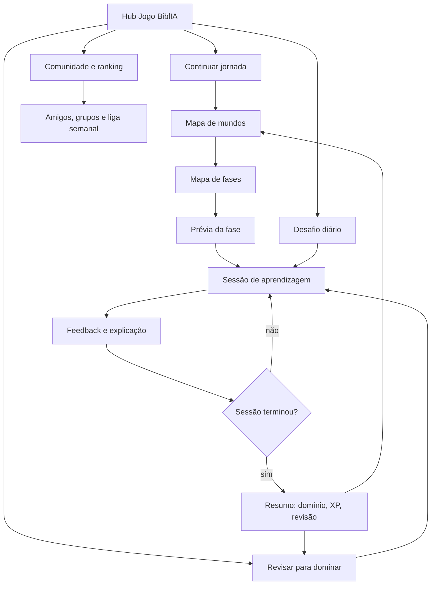

# BiblIA Jogo — Plano de Produto, UX e Escalabilidade

**Versão:** 1.0  
**Data:** 08 de novembro de 2026  
**Fuso horário de produto:** Africa/Maputo  
**Estado:** plano de referência para produto, conteúdo, UX, dados e implementação  
**Assinatura:** Codex

## 1. Visão do produto

O Jogo BiblIA transforma a leitura e o estudo bíblico em uma jornada pessoal de compreensão, prática e comunidade. A pessoa não “vence a Bíblia”; ela avança na sua caminhada, domina temas, revisa o que errou e celebra constância com outras pessoas.

O produto deve criar vontade de regressar porque oferece clareza de progresso, desafio adequado, descoberta e apoio social. Recompensas devem reconhecer ações que aproximam a pessoa do conteúdo: ler a passagem, responder, revisar um erro e manter um ritmo escolhido. Elas não devem explorar urgência falsa, perda punitiva, sorte, compras para vencer nem comparações humilhantes.

### Promessa de UX

Em menos de um minuto, qualquer pessoa deve conseguir responder a três perguntas:

1. O que posso fazer agora?
2. Por que isto importa na minha jornada?
3. O que avancei depois de terminar?

## 2. Decisões de produto que evitam improvisos futuros

| Decisão | Escolha para o BiblIA | Motivo |
|---|---|---|
| Métrica de aprendizagem | Estrelas de domínio por lição e tema | Mostra compreensão; não confunde conhecimento com tempo gasto. |
| Progresso de jornada | Mundos, fases e XP de caminhada | Dá contexto narrativo e desbloqueia conteúdo de forma compreensível. |
| Competição | Ligas sazonais semanais, opt-in, por pontos da semana | Mantém o ranking renovado e mais justo que um placar global vitalício. |
| Amigos | Código/QR/link primeiro; contactos e redes apenas com consentimento explícito | Funciona em grupos locais e reduz dependência de plataformas sociais. |
| Vidas | Ferramenta de feedback na sessão, nunca energia paga nem bloqueio temporal | O erro conduz à revisão e nova tentativa; ninguém paga para continuar a aprender. |
| Streak | Indicador opcional de ritmo, com recuperação e pausa planeada | Reforça hábito sem castigar doença, viagem ou um dia difícil. |
| IA | Dica contextual, explicação e plano de revisão; nunca resposta automática ao desafio | Preserva a aprendizagem e reduz respostas sem reflexão. |
| Pagamentos | Cosméticos, conveniências e conteúdo premium claramente separado do mérito | Não permite comprar XP, estrelas, posição no ranking ou vitórias. |

## 3. Fundamento motivacional e ético

A experiência usa três necessidades psicológicas como filtro para cada mecânica:

| Necessidade | Como aparece no jogo | Regra de proteção |
|---|---|---|
| Autonomia | Meta diária escolhida, modo de jogo, dificuldade sugerida mas ajustável, privacidade e notificações configuráveis | Sem missões obrigatórias, contagens regressivas fora da sessão ou opt-in social forçado. |
| Competência | Dificuldade adaptativa, explicação após resposta, revisão inteligente, estrelas por domínio e progresso visível | Nenhuma punição humilhante; erro sempre mostra passagem e próxima ação. |
| Comunidade | Amigos, grupos locais, desafios cooperativos, celebrações e ranking sazonal | Ranking é opcional, sem mensagens privadas por padrão e com bloqueio/denúncia. |

Badges, placares e gráficos podem apoiar percepção de competência; narrativas e equipas reforçam comunidade, desde que a pessoa mantenha escolha e controle. [Estudo de Sailer et al.](https://www.sciencedirect.com/science/article/pii/S074756321630855X) e uma [revisão de teoria da gamificação](https://doi.org/10.1016/j.chb.2021.106963) sustentam esse enquadramento. O plano exclui padrões como “quase ganhou” artificial, medo de perder recompensas e compras para recuperar vidas, porque diminuem autonomia e podem transformar o estudo em pressão. [Discussão sobre padrões manipulativos em jogos](https://journals.sagepub.com/doi/10.1177/15554120251319173)

## 4. Arquitetura da experiência



### 4.1 Hub: a página que decide o próximo passo

O `GameDashboard` deve ser o centro de decisão, não uma vitrine de cartões. No topo, mostra apenas o necessário: avatar, nível de caminhada, XP de vida e acesso a notificações. O corpo tem esta ordem:

1. **Continuar jornada**: uma CTA única que retoma a fase pendente, sem pedir decisão extra.
2. **Próximo pequeno passo**: Desafio Diário ou “Revisar 3 erros”, escolhido conforme o estado da pessoa.
3. **Progresso com significado**: mundo atual, percentagem e a próxima passagem/tema.
4. **Modos livres**: Quiz, Verdadeiro/Falso, Completar Versículo e Desafio Diário.
5. **Comunidade**: posição na liga semanal, amigos ativos e convite para grupo, sem forçar participação.

Os cartões atuais de dashboard, mapa, seleção de nível, prévia, quiz, V/F, lacunas, desafio diário, ranking, estatísticas, resumo e recompensa continuam sendo as superfícies certas. O trabalho é ligá-los a uma única fonte de estado e dar a cada um uma função definida neste fluxo.

### 4.2 Hierarquia de conteúdo

```
Testamento → Mundo → Capítulo/tema → Fase → Lição → Questão → Referência bíblica
```

- **Mundo**: arco temático de 5 a 10 fases. Exemplo: “Génesis: Começos”, “Êxodo: Libertação”, “Evangelhos: Caminhar com Jesus”.
- **Fase**: uma passagem ou conjunto pequeno de passagens, com objetivo claro, introdução e recompensa declarada.
- **Lição**: sessão de 3 a 7 questões, idealmente entre 3 e 7 minutos. Inclui pelo menos uma questão que exige voltar ao texto.
- **Tema**: etiqueta transversal como Criação, Aliança, Fé, Justiça, Parábolas ou Salmos. Alimenta revisão e estatísticas.

Uma fase não deve depender só de acertos. Para ganhar a terceira estrela, a pessoa pode concluir uma revisão posterior. Isto desloca o incentivo de velocidade para retenção.

### 4.3 Os sete mundos canónicos

Os mundos são a espinha narrativa do mapa. Cada um começa com uma introdução breve, contém 10 a 15 nós e termina com uma revisão de mundo. O conteúdo cresce por fases publicadas, sem alterar os identificadores ou o progresso de mundos já concluídos.

| Mundo | Título | Foco | Revisão de mundo | Conquista |
|---:|---|---|---|---|
| 1 | A Criação e o Éden | Génesis 1–11: criação, queda, dilúvio e Babel | Ordenar os dias da criação e ligar acontecimentos a referências | Pioneiro da Fé |
| 2 | A Aliança dos Patriarcas | Abraão, Isaac, Jacó e José | Relações e promessas da aliança | Filho da Promessa |
| 3 | O Êxodo e a Lei | Moisés, libertação, deserto e aliança | Mandamentos e percurso do êxodo | Liberto do Egito |
| 4 | A Terra Prometida e os Reinos | Josué, juízes, David, Salomão e reis | Coragem, liderança e sabedoria | Guardião da Aliança |
| 5 | Vozes dos Profetas | Elias, Isaías, Jeremias, Daniel e Jonas | Mensagem, contexto e esperança profética | Sentinela da Palavra |
| 6 | O Evangelho da Graça | Vida, parábolas, morte e ressurreição de Jesus | Parábolas, bem-aventuranças e missão | Discípulo de Cristo |
| 7 | A Igreja e a Esperança Final | Atos, cartas e Apocalipse | Missão, comunidades e esperança cristã | Servo Fiel |

Tipos de nó no mapa:

- **Lição**: sessão mista de 5 a 8 questões.
- **Memória**: completar versículo e recuperação espaçada.
- **Leitura guiada**: leitura breve que prepara uma lição ou uma revisão, sem ranking.
- **Baú de bênção**: marco de exploração que entrega conquista ou cosmético, nunca vantagem competitiva.
- **Revisão de mundo**: síntese de conteúdos anteriores; substitui a linguagem de “chefe” por uma experiência de celebração e domínio.

Estrelas por fase: a primeira pela conclusão, a segunda por precisão igual ou superior a 80%, e a terceira ao acertar uma revisão dessa fase após pelo menos três dias. A terceira estrela mede retenção, não repetição imediata.

## 5. Sessão de aprendizagem: regras únicas para os quatro modos

### Contrato de uma sessão

Cada sessão recebe `lessonId`, `mode`, conjunto versionado de questões, dificuldade, início e contexto. Toda questão recebe `questionId`, referência, explicação, dica e resposta correta no servidor. A UI nunca calcula ou inventa pontuação final sem validação posterior do servidor.

| Etapa | UX | Regra |
|---|---|---|
| Início | Objetivo, duração estimada, referência e opção de ouvir | Sem surpresa; a pessoa sabe o compromisso de tempo. |
| Questão | Texto legível, referência acessível, áudio opcional e botão de saída | Temporizador só em modo cronometrado voluntário; acessibilidade e áudio desativam pressão de tempo. |
| Resposta | Seleção imediata e bloqueio contra duplo toque | Eventos são idempotentes pelo `attemptId`. |
| Feedback | Certo ou a rever, explicação curta, referência e caminho “Ler passagem” | Sempre mostra por que, sem revelar conteúdo fora da passagem. |
| Continuação | Próxima questão ou conclusão | Erro reduz coração de sessão; nunca retira progresso já ganho. |
| Resumo | Domínio, XP, acertos, referências para revisão e próxima ação | Recompensa é derivada da tentativa validada. |

### Os quatro modos

| Modo | Função pedagógica | Formato ideal | Resultado |
|---|---|---|---|
| Quiz | Recordação e contexto | 4 alternativas, 5–10 questões; sem tempo por padrão | XP, domínio e erros para revisão. |
| Verdadeiro ou Falso | Discernimento de afirmações comuns | 5–10 afirmações, sempre com explicação e referência | Ajuda a corrigir confusões recorrentes. |
| Completar Versículo | Memorização e atenção ao texto | 2–4 lacunas, banco de palavras ou digitação assistida | Progresso de memória por passagem. |
| Desafio Diário | Pequena prática variada | 3 questões: uma de leitura, uma de discernimento e uma de memória | Bónus diário e sequência de hábito; uma conclusão por dia conta para ranking. |

O botão de dica consome uma das três formas de ajuda da sessão — referência, pista textual ou explicação parcial — e marca a questão como “aprendida com ajuda”. Isso mantém a recompensa honesta sem tornar a dica punitiva.

### Dificuldade adaptativa

Cada combinação `pessoa + tema + tipo de questão` guarda uma estimativa simples de domínio de 0 a 100. A primeira sessão usa o nível escolhido no onboarding. Depois:

- domínio abaixo de 40: mais contexto, 2 lacunas, alternativas menos próximas e revisão breve;
- 40 a 74: equilíbrio de formatos e dificuldade;
- 75 ou mais: alternativas plausíveis, referências cruzadas e recuperação espaçada;
- três erros no mesmo conceito: sugerir leitura guiada e retirar o temporizador;
- a pessoa pode escolher “mais leve”, “equilibrado” ou “desafiante” a qualquer momento.

## 6. Sistema de progresso e recompensas

### 6.1 Três trilhas, nunca uma só

| Trilha | Unidade | O que mede | Onde aparece |
|---|---|---|---|
| Caminhada | XP total e nível | Participação consistente e conclusão de lições | Perfil, hub e mapa. |
| Domínio | 0–3 estrelas por fase e percentagem por tema | Compreensão, revisão e retenção | Mapa de fases, estatísticas e revisão. |
| Liga | Talentos da Semana | Pontos validados em atividades elegíveis na semana | Ranking global semanal, amigos e grupos. |

**XP de caminhada** é permanente e não pode ser comprado. **Estrelas** são permanentes e exigem domínio. **Talentos da Semana** expiram quando a semana fecha e servem somente para a liga. A separação impede que alguém no topo do ranking vitalício pareça ter mais compreensão do que outra pessoa.

### 6.2 Regras iniciais de recompensa

| Ação validada | XP | Talentos da Semana | Estrela/domínio |
|---|---:|---:|---|
| Concluir lição | 20 | 10 | progresso base |
| Resposta correta sem dica | 5 | 2 | aumenta domínio do tema |
| Resposta correta com dica | 3 | 1 | aumenta domínio de forma menor |
| Revisar erro após intervalo | 8 | 2 | requisito para terceira estrela |
| Concluir desafio diário | 25 | 15 | reforça tema diário |
| Ler a passagem associada | 5, uma vez por fase | 0 | habilita contexto, não competição |

Os valores devem viver em configuração versionada no servidor, nunca dispersos no componente React. Qualquer ajuste passa por experimento limitado e auditoria de impacto.

### 6.3 Corações, tentativa e recuperação

- A sessão começa com 5 corações de feedback.
- Errar retira um coração daquela sessão e abre explicação; acertar depois numa revisão recupera confiança, não precisa recuperar uma moeda.
- Ao chegar a zero, a pessoa recebe duas saídas igualmente válidas: “Revisar a passagem agora” ou “Retomar mais tarde”. A revisão abre exatamente a referência da questão e propõe uma questão breve de confirmação; ao concluí-la, restaura um coração para aquela sessão.
- A restauração pela leitura é limitada à referência em causa e serve para preparar uma nova tentativa. Não exige rolar uma quantidade arbitrária de versículos e não prende a pessoa num bloqueio.
- Não há relógio de espera, anúncio, compra ou pedido de convidar amigos para receber vidas.

### 6.4 Conquistas

Conquistas são marcos narrativos e de aprendizagem, não uma lista infinita. Devem ter descrição, critério, data, imagem, referência e privacidade configurável.

Categorias iniciais:

- **Caminho**: primeira fase, primeiro mundo, 10 fases concluídas.
- **Leitura**: primeira passagem aberta a partir de uma questão, 30 leituras guiadas.
- **Memória**: primeiro versículo dominado, 10 revisões espaçadas.
- **Sabedoria**: 80% de domínio num tema, correção de uma confusão recorrente.
- **Comunidade**: primeiro amigo aceite, primeiro desafio cooperativo concluído.
- **Constância**: 3, 7, 30 e 100 dias de prática, respeitando pausa e recuperação de sequência.

## 7. Hábito diário sem pressão

### Meta e sequência

A pessoa escolhe uma meta diária de 3, 5, 10 ou 15 minutos, ou “sem meta”. A sequência conta um dia em que a meta foi atingida ou o Desafio Diário foi concluído. Cada dia mostra a contribuição real, nunca uma chama sem ação verificada.

Há duas proteções:

- **Pausa planeada**: até duas pausas mensais, configuradas antes do dia; não altera ranking.
- **Recuperação compassiva**: uma vez a cada 14 dias, concluir a revisão no dia seguinte mantém a sequência pessoal, mas não atribui Talentos retroativos.

### Notificações

Desligadas por padrão até a pessoa escolher uma hora. Opções: lembrete de meta, novo desafio, amigo convidou e resumo semanal. Cada categoria pode ser desligada e nenhuma mensagem usa culpa ou urgência falsa. As preferências respeitam configurações de movimento, tamanho e interrupções, em linha com a orientação de controle de notificações da [W3C](https://www.w3.org/TR/wcag3/).

## 8. Comunidade, amigos e ranking

### 8.1 Ordem de descoberta de amigos

1. **Código BiblIA, QR e link de convite**: opção padrão, simples e com consentimento dos dois lados.
2. **Pesquisa por nome de utilizador**: exige pedido e aceitação; nunca revela email ou telefone.
3. **Grupos locais**: código de grupo de igreja, célula, escola ou família. A entrada requer convite/aprovação; administradores têm papéis limitados.
4. **Contactos do dispositivo**: opção posterior e totalmente voluntária. O app calcula identificadores normalizados e com hash no dispositivo; envia somente hashes para comparação, com tela de permissão clara e opção de apagar a sincronização.
5. **Redes sociais**: servem para login ou partilha de convite. Integrações como Facebook ou Google Contacts só podem sugerir pessoas depois de uma autorização explícita, nunca criam amizade automaticamente. Não basear a estratégia de amigos no grafo de Facebook/Instagram; os acessos são voláteis, dependem de aprovação de plataforma e criam custo de privacidade.

O atual botão de “ligar Facebook e sincronizar amigos” deve virar “Convidar amigos” e abrir estas opções. OAuth de rede pode continuar como autenticação se for configurado, mas não promete importação de amigos.

### 8.2 Modelo social seguro

- Relação de amizade bilateral: `pending → accepted → blocked`.
- Sem chat direto no MVP. Reações pré-definidas positivas em conquistas, com limite de frequência.
- Perfil público mínimo: nome de exibição, avatar opcional, nível e estatística escolhida.
- Idade mínima, consentimento parental e regras de moderação devem ser definidos antes de abrir comunidade a menores.
- Bloquear e denunciar estão em perfil, ranking e grupos; denúncias criam fila de moderação auditável.

### 8.3 Rankings

O ranking deve incentivar pertença, não comparar valor espiritual.

| Ranking | Quem vê | Janela | Critério | Padrão |
|---|---|---|---|---|
| Amigos | Apenas amigos aceites | semanal | Talentos da Semana | ligado quando há amigos |
| Grupo local | membros do grupo | semanal | contribuição validada e metas cooperativas | opt-in ao grupo |
| Liga global | participantes que aderiram | semanal, por liga | Talentos da Semana e limite diário de pontos | desligado por padrão |
| Histórico pessoal | só a própria pessoa | permanente | domínio, tempo escolhido e constância | sempre disponível |

Ligas iniciais: Semente (Bronze), Caminho (Prata), Discípulo (Ouro), Mensageiro (Diamante) e Celestial. A cada segunda-feira, uma pessoa sobe, mantém ou desce de divisão conforme a posição, mas não perde XP, estrelas ou acesso a conteúdo. A liga Celestial pode ter um quadro público Top 100, mas todos os outros grupos ficam em faixas de 30–50 pessoas para tornar a posição legível e reduzir comparação excessiva.

Regras de justiça:

- limite diário de Talentos de ranking; revisões continuam dando domínio mesmo depois do limite;
- desempate: precisão e variedade de temas, nunca tempo de tela;
- posições e pontuação calculadas no servidor após validar tentativa;
- contas novas entram em liga de colocação e só aparecem no global após tentativas válidas;
- botão “sair da liga” remove visibilidade pública no próximo ciclo e mantém todo o progresso individual.

### 8.4 Tribos: cooperação antes de competição

`ClanHub` evolui para **Tribos**: grupos de família, célula, igreja ou amigos com nome, avatar, administrador e regras de entrada. A meta semanal combina leitura guiada e conclusão de revisões, por exemplo “200 passagens abertas e 80 revisões concluídas”. O painel mostra contribuição agregada e a pessoa pode ocultar os próprios números do grupo.

O Baú da Tribo entrega cosméticos, uma conquista coletiva e conteúdo cooperativo de reflexão. Não entrega vidas infinitas, XP de ranking ou vantagem em liga; uma tribo grande não deve ganhar uma vantagem estrutural sobre grupos pequenos.

## 9. Revisão inteligente e estatísticas

O `GameStats` deve deixar de ser só um painel celebrativo. Ele terá quatro abas:

1. **Visão geral**: XP, mundo, meta, tempo escolhido e precisão.
2. **Domínio**: temas e livros em “a iniciar”, “a praticar” e “dominado”.
3. **Revisar**: fila de erros e passagens por repetição espaçada; CTA “Revisar 3 agora”.
4. **Histórico**: sessões, desafios e conquistas, com filtros de privacidade.

Agendamento de revisão inicial: 1, 3, 7, 14 e 30 dias depois de erro ou acerto com dica. Um acerto seguro pode encurtar a fila; dois erros reintroduzem contexto e leitura. A pessoa pode ocultar um tema ou adiar uma revisão.

## 10. Conteúdo, teologia e qualidade pedagógica

Cada questão precisa de:

- tradução e edição bíblica autorizada;
- referência granular de livro, capítulo e versículo;
- resposta e explicação revisadas por editor de conteúdo;
- tema, nível, tipo, dificuldade e pré-requisitos;
- variantes aprovadas para não repetir a mesma questão;
- versão de conteúdo e estado: rascunho, revisão, publicado, arquivado.

Perguntas sobre doutrinas em que existem interpretações cristãs devem expor a passagem primeiro, usar linguagem respeitosa e, quando necessário, marcar a nota como “perspetivas cristãs”. Não usar o ranking para premiar respostas a perguntas teológicas controversas.

## 11. Arquitetura de dados e serviços

### Entidades principais

| Domínio | Tabelas/entidades mínimas |
|---|---|
| Catálogo | `worlds`, `phases`, `lessons`, `questions`, `question_options`, `content_versions`, `topic_tags` |
| Progresso | `user_world_progress`, `user_phase_progress`, `user_topic_mastery`, `review_queue`, `achievements`, `user_achievements` |
| Sessões | `game_attempts`, `attempt_answers`, `attempt_events`, `daily_challenges`, `daily_challenge_assignments` |
| Recompensas | `reward_rules`, `xp_ledger`, `weekly_talent_ledger`, `streaks` |
| Social | `friendships`, `friend_invites`, `groups`, `group_memberships`, `contact_match_tokens`, `reports`, `blocks` |
| Ranking | `seasons`, `leagues`, `league_memberships`, `leaderboard_snapshots` |

### Contratos importantes

- O cliente pede uma sessão; o servidor entrega uma versão de lição e um `attemptId` assinado/associado à conta.
- O cliente envia cada resposta com sequência, tempo e idempotency key. O servidor valida a questão, calcula recompensa, cria eventos e devolve o estado canónico.
- XP e Talentos usam livro razão imutável (`ledger`), em vez de atualizar um total sem histórico.
- O cliente pode manter fila offline criptograficamente identificada, mas o servidor revalida tudo ao sincronizar e rejeita duplicados ou ordem inválida.
- Políticas RLS: dados de pessoa, respostas e revisão são privados; liga só expõe campos públicos mínimos; relação de amigos exige bilateralidade.

### Escala e integridade

- Leituras de ranking vêm de snapshots/materialized views, não de soma ao vivo de milhões de tentativas.
- Fecho de liga ocorre em job agendado por semana e é idempotente.
- Limites de taxa por conta, dispositivo e IP protegem login, convite, início de sessão e envio de resposta.
- Registar versão de conteúdo permite corrigir uma pergunta sem reescrever o passado.
- Detecção de abuso: cadência impossível, respostas repetidas, múltiplas contas e convites em massa vão para revisão; não aplicar punição automática irreversível.

## 12. Mapeamento das telas atuais para a experiência alvo

| Tela existente | Papel final | Principal mudança |
|---|---|---|
| `GameDashboard` | hub de próxima ação | dados reais, CTA prioritária e resumo social opcional |
| `WorldMap` | mapa narrativo de mundos | progresso real; bloqueios sempre explicam requisito, nunca oferecem pagamento para avançar |
| `LevelSelectionScreen` | mapa de fases de um mundo | estrelas, estado de revisão e pré-requisitos por fase |
| `PhasePreviewModal` | compromisso informado antes da lição | objetivo, referências, duração, recompensa e acessibilidade; começa `lessonId` real |
| `QuizScreen` | recordação | sessão versionada e temporizador apenas voluntário |
| `GameTrueFalse` | discernimento | explicação, leitura e revisão por tema |
| `GameFillBlanks` | memorização | lacunas variáveis e repetição espaçada |
| `GameDailyChallenge` | hábito diário | atribuição por data de Maputo e conclusão validada |
| `GameLessonSummary` | reflexão e próxima ação | resultado real, domínio e revisão sugerida |
| `RewardModal` | celebração curta antes do resumo | recompensa real de ledger; reduz animação se o sistema pedir menos movimento |
| `GameLeaderboard` | ligas e amigos | ranking semanal, opt-in e convite próprio em vez de sincronização Facebook |
| `GameStats` | domínio e revisão | filas de revisão, progresso por tema e preferências de privacidade |

## 13. Plano de entrega

| Fase | Duração | Resultado concreto | Critério de aceite |
|---|---:|---|---|
| G0. Fundação de regras | 2–3 dias | Taxonomia de mundos/fases/temas, regras versionadas de XP/estrelas/talentos, protótipo de sessão e decisões teológicas/editoriais | Documento aprovado; nenhum componente possui regra de pontuação fixa. |
| G1. Loop individual completo | 4–6 dias | Quiz, V/F e lacunas em sessões reais de conteúdo local; resumo, tentativas, vidas pedagógicas, domínio e revisão local | Uma pessoa inicia, termina, falha, retoma e revisa uma lição sem inconsistências. |
| G2. Jornada e desafio diário | 3–4 dias | Sete mundos, fases, nós de memória/revisão, estrelas, meta, sequência com pausa/recuperação e desafio diário de Maputo | Progresso e desafios usam uma única fonte de estado e não dependem de valores fixos no componente. |
| G3. Backend de jogo | 5–7 dias | Schema Supabase, RLS, Edge Functions de validação, ledger, sincronização e fila offline | Duas contas não veem dados privados uma da outra; respostas duplicadas não duplicam recompensa. |
| G4. Social e ligas | 5–7 dias | Convites, amigos, grupos, snapshots de liga semanal, perfis públicos mínimos, bloqueio/denúncia | Uma pessoa pode convidar, aceitar, sair, bloquear e disputar liga sem expor contactos ou dados privados. |
| G5. Conteúdo e adaptação | contínuo, primeira versão 5–7 dias | Primeiro mundo completo, banco de variantes, revisão espaçada e dificuldade adaptativa inicial | Cada questão publicada tem fonte, explicação e revisão editorial. |
| G6. Qualidade e piloto | 5–7 dias | Acessibilidade, telemetria, antiabuso, dispositivos reais, moderação e piloto fechado | Métricas e incidentes do piloto atendem limites aprovados antes de abrir o ranking global. |

### Ordem obrigatória

G0 → G1 → G2 → G3. G4 só abre para utilizadores depois de privacidade, bloqueio e denúncia. G5 cresce em paralelo a G1–G3. G6 é requisito de lançamento, não etapa opcional.

## 14. Métricas de produto e limites de saúde

| Área | Métrica útil | Limite/decisão |
|---|---|---|
| Aprendizagem | melhoria de precisão numa revisão, conclusão de leitura, temas dominados | Não otimizar apenas minutos de uso ou sessões por dia. |
| Retenção | pessoas que regressam voluntariamente em 7 e 28 dias | Comparar por meta escolhida, nunca pressionar por streak. |
| Qualidade | abandono por questão, uso de dica, denúncia de pergunta, taxa de erro por conteúdo | Questão problemática sai de publicação e entra em revisão. |
| Comunidade | convites aceites, grupos ativos, bloqueios e denúncias resolvidas | Crescimento social não justifica baixar requisitos de moderação. |
| Competição | participação opt-in, distribuição de liga, desistência após rebaixamento | Ajustar liga se houver humilhação, desigualdade ou abuso. |
| Acessibilidade | conclusão com leitor de ecrã, zoom, modo escuro e movimento reduzido | Nenhuma função de aprendizagem exige animação, cor ou temporizador. |

## 15. Riscos e decisões que exigem definição antes de implementar

| Tema | Decisão necessária | Impacto |
|---|---|---|
| Tradução bíblica | quais versões e licenças podem ser usadas em perguntas, leitura e áudio | bloqueia publicação de conteúdo completo |
| Público menor de idade | idade mínima, consentimento e regras para grupos/ranking | bloqueia social aberto |
| Denominações | linha editorial, revisores e tratamento de temas com divergência | define confiança teológica |
| Redes sociais | quais provedores só para login/partilha e quais serão suportados | evita prometer importação de amigos não suportada |
| Grupos locais | quem cria, quem modera e como verificar liderança | define segurança comunitária |
| Pagamentos | quais conveniências premium são aceitáveis | protege mérito e acesso pedagógico |

## 16. Definição de “jogo pronto para lançar”

O jogo está pronto para lançamento quando:

- o primeiro mundo completo tem conteúdo licenciado e revisão editorial;
- os quatro modos funcionam numa sessão ponta a ponta com dados reais;
- progresso, domínio, XP, streak e desafio diário persistem e sincronizam com RLS;
- cada recompensa é calculada e auditável no servidor;
- ranking semanal e amigos são opt-in, privados por padrão e têm bloqueio/denúncia;
- a leitura contextual pode restaurar uma tentativa através de revisão, sem espera, compra ou conteúdo arbitrário;
- os sete mundos têm roteiro editorial, fases publicadas e revisões de mundo;
- a pessoa pode aprender plenamente sem competir, receber notificações ou pagar;
- acessibilidade, redução de movimento, telas pequenas/grandes e modo offline degradado foram verificados;
- piloto fechado mostra que pessoas entendem o próximo passo, encontram referências e não relatam pressão ou confusão material.

## 17. Primeira ação recomendada

Executar G0 antes de continuar a alterar telas: converter as regras deste plano em contratos TypeScript e em dados de conteúdo, definir o primeiro mundo completo e aprovar a política de recompensas. Em seguida, terminar G1 sobre esses contratos. Isso evita que os quatro ecrãs de jogo cresçam com lógica incompatível.
