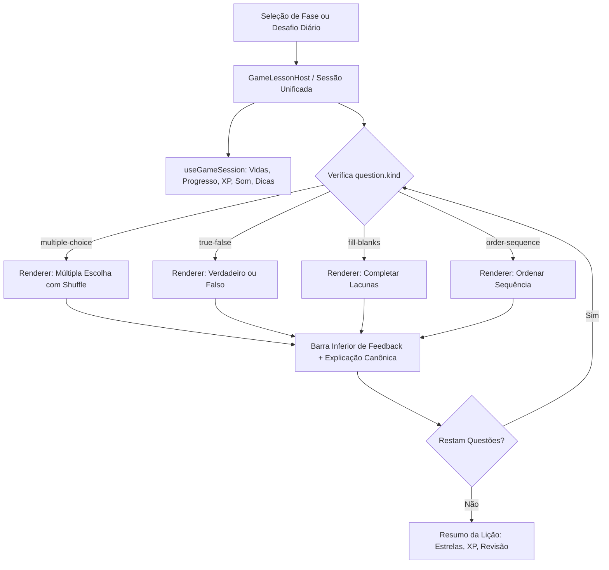

# BiblIA — Plano de Melhorias do Jogo: Intercalação de Modalidades e Dinâmica Pedagógica

**Data:** 17 de novembro de 2026  
**Fuso Horário:** Africa/Maputo  
**Estado:** Plano de Engenharia e Design de Jogo para Execução  
**Documento Base:** `PLANO_JOGO_BIBLIA.md` (Versão 1.0)  
**Autor/Assinatura:** Antigravity AI Engine  

---

## 1. Sumário Executivo e Diagnóstico de Problemas

O módulo de gamificação do BiblIA tem como propósito converter o estudo das Escrituras numa experiência interativa inspirada em mecânicas modernas de retenção (estilo *Duolingo bíblico*), equilibrando autonomia, competência e reverência ao texto sagrado. 

Uma auditoria aprofundada ao código-fonte (`src/components/gamification/`, `src/lib/gameSession.ts`, `src/hooks/useGameSession.ts` e `src/data/canonicalGameData.ts`) identificou dois estrangulamentos críticos que comprometem o engajamento e a validade pedagógica:

### 1.1 Vício da Alínea "A" (Opção correta sempre na primeira posição)
* **Causa no Catálogo (`canonicalGameData.ts`)**: No banco canônico do Mundo 1, 100% das questões do tipo `multiple-choice` foram cadastradas com a resposta correta no índice 0 (`options[0] === answers[0]`).
* **Causa na Interface (`QuizScreen.tsx`)**: O componente consome o array cru (`const options = question.options || [];`) e o mapeia sequencialmente para os botões A, B, C e D.
* **Efeito**: Não há embaralhamento (*shuffle*). O utilizador descobre rapidamente que a primeira alternativa é sempre a correta, dispensando a leitura do versículo e quebrando o ciclo de aprendizagem.

### 1.2 Fragmentação em "Silos Monotemáticos" (Ausência de Intercalação)
* **Telas Isoladas**: Cada modalidade foi codificada como uma tela fechada (`QuizScreen.tsx`, `GameTrueFalse.tsx`, `GameFillBlanks.tsx`).
* **Roteamento Rígido por Fase**: Em `LevelSelectionScreen.tsx`, o início de uma fase despacha o utilizador para uma tela única baseada no `selectedPhase.mode`. Se a fase for de quiz, o utilizador responde a 5 perguntas seguidas do mesmo tipo.
* **Desafio Diário Preso a Lacunas**: Em `GameDailyChallenge.tsx`, o botão iniciar força o roteamento para `screen-jogo-fill`, contrariando a Secção 5 do `PLANO_JOGO_BIBLIA.md`, que determina uma prática mista (leitura + discernimento + memória).
* **Ausência de Orquestrador Dinâmico de Lição**: Falta um container unificado que receba um lote heterogêneo de questões e renderize a interface correspondente para cada questão dentro da mesma sessão contínua.

---

## 2. Matriz de Modalidades e Estratégias Pedagógicas

| Modalidade | Status no App | Função no Estudo Bíblico | Nova Estratégia de Implementação |
| :--- | :--- | :--- | :--- |
| **Múltipla Escolha (Quiz)** | Ativa (Previsível) | Recordação contextual, identificação de personagens, lugares e eventos | Embaralhamento aleatório Fisher-Yates por questão; distratores bíblicos plausíveis; temporizador voluntário. |
| **Verdadeiro ou Falso (V/F)** | Ativa (Isolada) | Quebra de mitos populares e discernimento de afirmações bíblicas | Intercalado logo após questões de contexto para validar a compreensão conceitual com explicação imediata. |
| **Completar Versículo (Lacunas)** | Ativa (Isolada) | Memorização exata do texto sagrado e atenção a termos-chave | Posicionado como exercício de fixação; banco de palavras móvel com 4 a 6 opções clicáveis. |
| **Ordenar Sequência (`order-sequence`)** | Proposta Nova | Cronologia de episódios, dias da criação, passos de um milagre | Blocos de eventos ordenáveis (ex: organizar a sequência dos 6 dias de Gênesis 1). |
| **Ligar Pares (`match-pairs`)** | Proposta Nova | Associação conceitual (Profeta ↔ Livro, Aliança ↔ Promessa) | 3 ou 4 pares de cartas bíblicas para revisão de mundo. |

---

## 3. Arquitetura da Solução: O Orquestrador Dinâmico (`GameLessonHost`)

Em vez de redirecionar o utilizador para telas distintas conforme o modo, toda a jornada de fases e desafios passa a ser executada por um **Orquestrador Dinâmico de Sessão**:

### Componentes do `GameLessonHost`:
1. **Header Universal**:
   * Botão Fechar / Sair com confirmação;
   * Barra de progresso linear contínua (% da lição);
   * Contador de corações pedagógicos (5 vidas) com animação;
   * Alternador de efeitos sonoros (*Mute/Unmute*) e botão de áudio TTS para leitura em voz alta.
2. **Área de Exercício Intercambiável**:
   * Renderiza dinamicamente o subcomponente específico conforme `question.kind`.
3. **Footer Unificado de Validação**:
   * Estado de espera: Botão "Verificar Resposta" (desabilitado até seleção);
   * Estado de acerto: Banner verde com som `correct`, versículo de referência e botão "Continuar";
   * Estado de erro: Banner vermelho com som `wrong`, nota pedagógica contextual, versículo e opção "Ler na Bíblia para recuperar coração".

---

## 4. O Formato da "Lição Híbrida Canônica"

Cada fase do Mundo 1 e dos mundos seguintes é estruturada em uma sessão de **5 a 6 questões balanceadas**:

* **Passo 1 — Abertura (Contexto)**: Questão de Múltipla Escolha sobre o cenário do texto (ex: "O que Deus criou no princípio?").
* **Passo 2 — Discernimento**: Questão de Verdadeiro ou Falso para confrontar equívocos comuns (ex: "V/F: A terra já estava povoada antes da palavra criadora de Deus?").
* **Passo 3 — Aprofundamento**: Múltipla Escolha com opção de Dica bíblica (ex: "Qual o nome dado à porção seca e ao ajuntamento das águas?").
* **Passo 4 — Discernimento Rápido**: Verdadeiro ou Falso de aplicação da passagem.
* **Passo 5 — Memorização (Clímax da Lição)**: Completar Versículo com banco de palavras (ex: "E disse Deus: Haja ___; e houve ___.").

---

## 5. Reestruturação do Desafio Diário

O Desafio Diário (`GameDailyChallenge.tsx`) deixa de rodar apenas lacunas e adota a **Tríade Sagrada Diária** (3 a 4 minutos de compromisso):
1. **Questão 1**: 1 Múltipla Escolha de leitura bíblica do dia;
2. **Questão 2**: 1 Verdadeiro ou Falso de reflexão e discernimento;
3. **Questão 3**: 1 Completar Versículo do versículo-chave do dia.

Ao completar a tríade:
* Atualiza a sequência diária (*streak* no fuso de Maputo);
* Concede bônus diário de XP (+25 XP) e Talentos (+15 Talentos);
* Acende a chama no perfil e registra a data em `biblia:daily-completions`.

---

## 6. Plano de Execução em Fases

### Fase 1: Correção do Embaralhamento (Shuffle) da Múltipla Escolha
- [ ] Implementar utilitário `shuffleArray<T>()` em `src/lib/gameSession.ts`.
- [ ] Integrar embaralhamento no `QuizScreen.tsx` (e nos componentes de quiz) atrelado ao `questionIndex`, preservando a correta validação de `isCorrect`.
- [ ] Testar que a alternativa correta aparece distribuída entre A, B, C e D.

### Fase 2: Construção do Host Dinâmico de Lições (`GameLessonHost.tsx`)
- [ ] Criar `src/components/gamification/GameLessonHost.tsx`.
- [ ] Modularizar os renderizadores de exercício:
  - `MultipleChoiceExercise.tsx`
  - `TrueFalseExercise.tsx`
  - `FillBlanksExercise.tsx`
- [ ] Integrar `useGameSession` unificado controlando vidas, pontuação, XP, dicas e áudio TTS.
- [ ] Registrar rota `screen-jogo-licao` em `App.tsx`.

### Fase 3: Reformulação do Catálogo de Fases do Mundo 1
- [ ] Reestruturar `WORLD_1_QUESTIONS` em `src/data/canonicalGameData.ts` para que as fases 1 a 10 contenham exercícios híbridos (Quiz + V/F + Lacunas).
- [ ] Atualizar `LevelSelectionScreen.tsx` para despachar as fases para o `GameLessonHost`.

### Fase 4: Atualização do Desafio Diário
- [ ] Criar conjunto diversificado de questões diárias em `gameContent.ts` (`DAILY_QUESTIONS_TRIAD`).
- [ ] Fazer `GameDailyChallenge.tsx` despachar para a sessão híbrida em vez de forçar `screen-jogo-fill`.

### Fase 5: Validação, Build e Homologação
- [ ] Executar build TypeScript completo com `npm.cmd run build`.
- [ ] Validar ausência de regressões em vidas, som e persistência.
- [ ] Registrar marco de progresso em `bibliadev.md` e no espelho `bibliadev`.

---

## 7. Critérios de Aceitação

1. **Anti-Previsibilidade**: Em 10 rodadas consecutivas de múltipla escolha, a alternativa correta deve variar estatisticamente entre as posições A, B, C e D.
2. **Alternância Fluida**: Uma fase de jornada deve alternar entre pelo menos 2 tipos de exercícios distintos dentro da mesma sessão sem recarregar a tela.
3. **Desafio Diário Misto**: O desafio diário deve apresentar questões de modalidades diferentes.
4. **Vidas e Som**: Erros continuam subtraindo 1 coração; o botão "Ler na Bíblia para Recuperar" permanece funcional.
5. **Build Limpo**: `npm.cmd run build` com Exit Code 0 sem erros de TypeScript.
