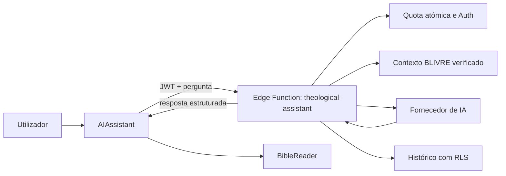

# BiblIA — Plano de Conclusão da Secção 4: Assistente Teológico

**Estado:** Fundação 4.1 implementada no código e pronta para aplicar/deploy no Supabase. Nenhuma chave de IA será colocada no browser.

## Decisão de produto

O Assistente será **bíblico, cristocêntrico e interdenominacional**. A Escritura será a fonte principal; explicações históricas e interpretações serão identificadas como tal. Quando houver divergência relevante, a resposta apresentará as perspetivas de forma equilibrada, sem declarar uma tradição como a única leitura válida.

O primeiro lançamento não tentará ser uma enciclopédia teológica. Terá quatro capacidades: explicar uma passagem, dar contexto histórico, comparar leituras bíblicas relacionadas e propor uma reflexão ou oração curta fundamentada nas Escrituras.

## Auditoria inicial

| Área | Estado atual | Correção necessária |
|---|---|---|
| Resposta IA | `AIAssistant.tsx` usa textos fixos e `setTimeout` | Substituir por chamada segura a backend real |
| Citações | Referências fixas, sem validação | Exigir referências estruturadas e validar contra BLIVRE |
| Limites | Contador local de 3 perguntas, com renovação simulada | Aplicar quota atómica no servidor por utilizador e dia |
| Histórico | Apenas memória do componente | Persistir conversas e mensagens com RLS |
| Segurança | Não há Edge Function nem segredo de fornecedor | Criar função autenticada; segredo apenas no ambiente da função |
| Leitor | Não recebe links de referências vindas da IA | Abrir referência validada no BibleReader |
| Voz da IA | Usa `speechSynthesis` diretamente | Reutilizar as preferências de voz/volume já existentes no motor de áudio |

## Arquitectura aprovada



O browser chama apenas a Edge Function. A função valida a sessão, aplica quota, monta o contexto e chama o fornecedor. A chave do fornecedor fica em segredo de produção/local da função, nunca em `VITE_*`, nunca em código React e nunca em `localStorage`. Supabase recomenda segredos de Edge Functions por variáveis de ambiente, e as chaves de privilégios elevados não devem ir para o browser. [Documentação de segredos](https://supabase.com/docs/guides/functions/secrets)

## Contrato de resposta

Cada resposta do backend terá esta forma:

```ts
type AssistantReply = {
  answer: string;
  kind: 'study' | 'devotional' | 'prayer' | 'clarification';
  references: Array<{ book: string; chapter: number; verses: number[]; label: string }>;
  interpretationNote?: string;
  safetyNote?: string;
  conversationId: string;
  usage: { remainingToday: number };
};
```

A Edge Function valida livro, capítulo e formato da referência antes de devolver a resposta. Em seguida, o cliente resolve cada versículo contra o capítulo BLIVRE efetivamente instalado antes de o tornar clicável; se o modelo inventar uma referência, ela é removida. Quando o corpus canónico for disponibilizado também no ambiente da função, esta validação por versículo será duplicada no backend. O texto bíblico exibido no app virá sempre do corpus local, não do texto gerado pelo modelo.

## Regras teológicas e pastorais

- Separar claramente: **texto bíblico**, **contexto**, **interpretação** e **aplicação devocional**.
- Apresentar leituras divergentes como perspetivas de tradições cristãs identificáveis.
- Não alegar revelação, autoridade divina, diagnóstico, aconselhamento médico/jurídico ou certeza sobre decisões pessoais.
- Em risco de autoagressão, violência ou emergência, interromper a conversa devocional normal, encorajar contacto imediato com serviços locais de emergência e pessoa de confiança.
- Não inventar versículos, citações, autores ou fontes. Admitir incerteza quando ela existir.
- Não usar dados de conversa para treinar fornecedor sem uma decisão e consentimento documentados.

## Dados e segurança

Nova migração `202611..._ai_assistant.sql`:

- `ai_conversations`: id, user_id, title, context_reference, created_at, updated_at;
- `ai_messages`: id, conversation_id, role, content, references JSONB, created_at;
- `ai_daily_usage`: user_id, usage_date, request_count, input_tokens, output_tokens, updated_at;
- `ai_request_audit`: id, user_id, provider, model, status, latency_ms, token_count, created_at; sem texto integral da pergunta por padrão.

RLS: o utilizador só lê, cria e elimina as suas próprias conversas/mensagens. A Edge Function usa operações de servidor apenas onde necessário. A quota será reservada numa função SQL atómica antes de chamar o fornecedor; em falha do fornecedor, a reserva é revertida ou marcada como não cobrável.

Não haverá encadeamento de Edge Functions para esta capacidade. A função fará uma chamada externa ao fornecedor e uma consulta de dados direta, evitando fan-out. Rate limiting por utilizador pode ser feito por armazenamento atómico ou Redis; a referência oficial da Supabase demonstra rate limiting por ID de utilizador. [Exemplo oficial](https://supabase.com/docs/guides/functions/examples/rate-limiting)

## Fases de execução e portas de saída

### Fase 4.1 — Fundação segura

Criar migração, RLS, função SQL de quota, tipos partilhados e interface `assistantService`. Criar Edge Function com autenticação, CORS restrito, validação de payload e resposta de indisponibilidade quando não houver fornecedor configurado.

**Porta:** sem chave no bundle; chamada não autenticada rejeitada; quota não pode ser alterada pelo cliente.

**Implementação registada — 17/11/2026:** criada a migração `20261117000003_ai_assistant_foundation.sql`, a Edge Function `theological-assistant` e o cliente `assistantService`. A função aceita Gemini ou OpenAI apenas por segredos do ambiente, usa autenticação, CORS por origem permitida, tamanho máximo de pergunta, quota SQL atómica, auditoria sem guardar a pergunta e devolução da quota se o fornecedor falhar. A ativação real depende de aplicar a migração, fazer deploy da função e configurar os segredos de produção.

### Fase 4.2 — Contexto bíblico e prompt

Criar resolvedor de referências BLIVRE e prompt de sistema versionado. Implementar verificação de referências da resposta e contexto explícito de versículo/capítulo selecionado.

**Porta:** testes de casos com referências válidas, inválidas, teologia controversa e ausência de informação; nenhuma citação inventada chega à interface.

**Implementação parcial — 17/11/2026:** `assistantReferenceResolver.ts` passou a carregar o capítulo BLIVRE referido e elimina versículos inexistentes antes de a citação chegar à interface ou ao histórico. Falta a cópia equivalente no servidor, que exige disponibilizar o índice de versículos BLIVRE no ambiente da função.

**Contexto de leitura — 17/11/2026:** cada nova pergunta envia apenas a referência da última passagem que a pessoa leu (livro, capítulo e versículo), validada pela função antes de ser usada como ponto de partida do estudo. O texto canónico não é inventado nem enviado como instrução livre pelo browser.

### Fase 4.3 — Conversa e histórico

Substituir respostas simuladas, persistir conversas, criar nova conversa, retomar conversa e estados de carregamento, limite, sessão ausente e falha de rede.

**Porta:** histórico isolado por utilizador; falha não perde texto digitado; sem Supabase configurado a interface declara que o serviço ainda não está disponível.

### Fase 4.4 — Integração com Bíblia e áudio

Tornar referências clicáveis para abrir o BibleReader na passagem correta. Usar o motor de áudio comum para ler respostas, respeitando voz, velocidade e volume escolhidos.

**Porta:** uma referência da IA abre a passagem correta; leitura em voz alta respeita as preferências já definidas.

### Fase 4.5 — Custos, abuso e homologação

Configurar limites por plano no servidor, auditoria de consumo, timeout, tamanho máximo de pedido/resposta, bloqueio de repetição e painel mínimo de operações. Fazer revisão teológica de um conjunto de perguntas representativas e homologação do utilizador.

**Porta:** fornecedor real configurado por segredo, custo mensurável, respostas não simuladas, build limpo e aprovação funcional/teológica.

## Decisões que ficam para a execução

1. Escolher fornecedor/modelo depois de comparar qualidade em português, preço por token, retenção de dados e disponibilidade comercial no país de lançamento.
2. Aprovar a política de limites por plano após medir custo real do piloto; não assumir “perguntas ilimitadas”.
3. Só adicionar RAG com dicionários, comentários ou materiais teológicos depois de cada fonte ter licença e proveniência verificadas. A primeira versão usará BLIVRE e o contexto canónico já integrado.

## Critério de conclusão

A Secção 4 estará concluída quando uma pessoa autenticada conseguir enviar perguntas reais, receber resposta do fornecedor através de backend seguro, abrir referências BLIVRE verificadas, retomar o histórico próprio e encontrar limites/erros tratados. A revisão teológica aprova uma bateria de respostas antes da publicação.
