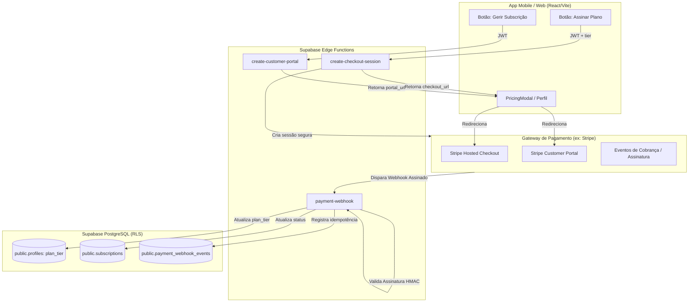

# BiblIA — Plano de Execução da Secção 5: Membresia e Assinaturas Reais

**Data:** 20 de novembro de 2026  
**Fuso Horário:** Africa/Maputo  
**Estado:** Proposta Técnica e Arquitetura de Pagamentos para Aprovação  
**Documento Base:** `PLANO_DESENVOLVIMENTO_BIBLIA.md` (Secção 5)  
**Autor/Assinatura:** Antigravity AI Engine  

---

## 1. Sumário Executivo e Diagnóstico de Segurança

Atualmente, o BiblIA possui uma interface de planos visualmente polida (`PricingModal.tsx`, `ProfileScreen.tsx`) e um simulador de eventos (`WebhookSimulatorDrawer.tsx`), mas a lógica de assinatura opera em **modo puramente demonstrativo no frontend**:

1. **Vulnerabilidade de Autorização no Cliente**: A função `activatePlan(tier)` em `SubscriptionContext.tsx` atualiza o campo `profiles.plan_tier` diretamente através da API pública do Supabase com a chave anónima do utilizador. Qualquer utilizador técnico poderia alterar o seu próprio plano para `MASTER` executando um simples comando JavaScript no console do navegador.
2. **Ausência de Gateway Real**: Os planos de $1,49 (PREMIUM) e $2,99 (MASTER) não estão ligados a nenhum processador de pagamento.
3. **Simulador em Produção**: O simulador de webhooks (`WebhookSimulatorDrawer.tsx`) reside no bundle principal e manipula o estado local.

---

## 2. Princípios de Segurança e Regras Inegociáveis

1. **Princípio do Privilégio Mínimo no Cliente**: O frontend **NUNCA** altera diretamente o `plan_tier`, `is_master_badge` ou as datas de subscrição.
2. **Autoridade Exclusiva do Webhook do Servidor**: O nível de membresia do utilizador no banco de dados só pode ser promovido, renovado, rebaixado ou cancelado por uma **Edge Function segura** acionada por um webhook assinado criptograficamente pelo gateway de pagamento.
3. **Idempotência Estrita**: Webhooks podem ser reenviados por falhas de rede. A Edge Function deve registrar o `event_id` do provedor e ignorar eventos duplicados.
4. **Isolamento de Segredos**: As chaves secretas do provedor de pagamentos (`STRIPE_SECRET_KEY`, `STRIPE_WEBHOOK_SECRET`, etc.) residem **exclusivamente** nos segredos de ambiente da Edge Function do Supabase, nunca em variáveis `VITE_*` ou no código React.
5. **Garantia Bíblica Livre**: O cancelamento ou expiração de qualquer plano pago reverte o utilizador para o plano `FREE`, que mantém **100% dos 66 livros da Bíblia Livre e áudio local permanentemente acessíveis**. Nenhum utilizador é impedido de ler as Escrituras por falta de pagamento.

---

## 3. Arquitetura da Solução

---

## 4. Máquina de Estados da Subscrição

| Evento do Gateway | Ação no `public.subscriptions` | Ação no `public.profiles` | Efeito no App |
| :--- | :--- | :--- | :--- |
| `checkout.session.completed` | Cria subscrição com status `active`, grava `customer_id` e `subscription_id` | `plan_tier = 1` ou `2`, `is_master_badge = true` (se tier 2) | Desbloqueia jornadas exclusivas, quotas ampliadas de IA e badge. |
| `invoice.payment_succeeded` | Atualiza `current_period_end` (+30 dias) e status `active` | Mantém `plan_tier` | Continuidade sem fricção. |
| `invoice.payment_failed` | Atualiza status para `past_due` | Mantém `plan_tier` por período de graça (3 dias) | Exibe banner discreto no perfil: "Houve um problema na renovação do seu plano". |
| `customer.subscription.updated` (cancel_at_period_end) | Marca `cancel_at_period_end = true` e grava `cancelled_at` | Mantém `plan_tier` pago até `current_period_end` | Usuário usufrui de todo o período já pago; no perfil indica "Cancela em DD/MM". |
| `customer.subscription.deleted` (expiração final) | Atualiza status para `expired` | `plan_tier = 0`, `is_master_badge = false` | Reverte pacificamente para o plano FREE. Leitura da Bíblia permanece intacta. |

---

## 5. Fases de Execução da Secção 5

### Fase 5.1 — Fundação de Dados e Migração SQL no Supabase
- Criar a migração `supabase/migrations/20261120000001_payment_and_subscriptions.sql`:
  - Tabela `payment_webhook_events` com chave única no `event_id` para garantir idempotência;
  - Restrições de segurança na tabela `subscriptions` (bloqueio de mutação direta via cliente `anon`/`authenticated`);
  - Função PL/pgSQL transacional `apply_subscription_event` executada exclusivamente por `service_role`.

### Fase 5.2 — Edge Function de Webhook Seguro (`payment-webhook`)
- Criar Edge Function `payment-webhook` no Supabase:
  - Validação estrita de assinatura (`Stripe-Signature` com chave secreta `STRIPE_WEBHOOK_SECRET`);
  - Tratamento transacional dos 5 eventos do ciclo de vida da subscrição;
  - Rejeição de requisições adulteradas ou sem assinatura válida com HTTP 400.

### Fase 5.3 — Edge Function de Checkout e Portal (`payment-checkout`)
- Criar Edge Function `payment-checkout`:
  - Recebe o ID do plano (`PREMIUM` ou `MASTER`);
  - Identifica o utilizador através do JWT da sessão;
  - Gera a sessão no gateway com URLs de retorno (`success_url` e `cancel_url`);
  - Retorna a URL segura para redirecionamento.

### Fase 5.4 — Refatoração do Frontend
- Atualizar `src/lib/subscriptionService.ts` e `src/context/SubscriptionContext.tsx`:
  - Remover mutações diretas de `profiles` no cliente;
  - `activatePlan(tier)` passa a chamar a Edge Function de checkout e redirecionar para a página segura;
  - `PricingModal.tsx`: Substituir o botão "Ativar Simulador" pelo fluxo de pagamento real com indicador de carregamento seguro;
  - `ProfileScreen.tsx`: Exibir informações reais de faturamento (data de renovação, cancelamento agendado) e botão "Gerir Assinatura" (abre o Portal de Cliente);
  - Condicionar `WebhookSimulatorDrawer.tsx` para ser removido do bundle de produção ou ativado apenas se explicitamente em modo sandbox de desenvolvimento.

### Fase 5.5 — Testes de Ciclo de Vida e Homologação
- Testar fluxo completo com cartões de teste de sucesso, falha e 3D Secure;
- Testar cancelamento voluntário e preservação de acesso até o fim do período;
- Testar expiração e reversão limpa para o plano FREE;
- Validação completa com `npm.cmd run build` (Exit Code 0).

---

## 6. Decisões de Produto Necessárias do Utilizador

1. **Escolha do Provedor de Pagamentos Inicial**:
   - **Recomendação**: **Stripe** (suporte global a cartões Visa/Mastercard, Apple Pay, Google Pay, webhooks nativos no Deno/Supabase e modo de teste sandbox completo e gratuito para desenvolvimento).
2. **Preços e Moedas**:
   - Manter os valores aprovados no PRD:
     - **PREMIUM**: US$ 1,49 / mês
     - **MASTER**: US$ 2,99 / mês
   - *Nota*: O Stripe permite cobrança na moeda local do cliente com conversão automática.
3. **Período de Graça em Falha de Pagamento**:
   - Padrão recomendado: 3 dias de tolerância em caso de falha de cartão antes de reverter para o plano FREE.

---

## 7. Critérios de Aceitação

1. O cliente frontend não possui qualquer permissão RLS para alterar o seu próprio `plan_tier`.
2. O plano só é promovido quando o webhook do servidor recebe um evento autenticado com assinatura válida.
3. Tentativas de forjar webhooks sem a assinatura criptográfica são rejeitadas com erro 400.
4. O utilizador pode gerir e cancelar a sua assinatura pelo portal oficial do gateway.
5. O cancelamento nunca bloqueia o acesso à Bíblia.
6. Build limpo sem erros TypeScript.
